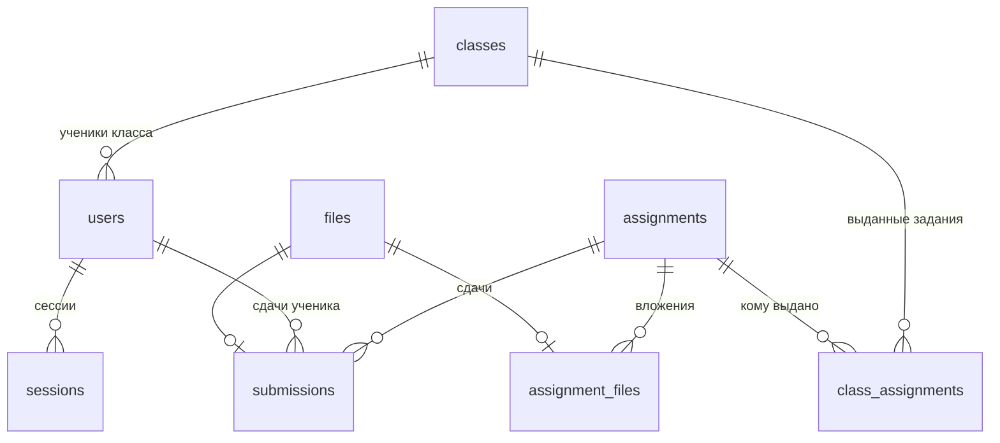

# База данных

Схема — [migrations/00001_init.sql](../migrations/00001_init.sql). Здесь описано, как она устроена и почему именно так. Требования — в [Decisions.md](Decisions.md).

## Таблицы



| Таблица | Что хранит |
|---|---|
| `classes` | Классы |
| `users` | Учитель и ученики. У ученика обязательно есть класс, у учителя класса нет |
| `sessions` | Сессии входа: хэш токена из cookie и срок действия |
| `assignments` | Задания: название, описание, количество задач |
| `assignment_files` | Файлы, приложенные к заданию |
| `class_assignments` | Какому классу выдано задание и с каким дедлайном |
| `submissions` | Сдачи: ученик, задание, файл, состояние, балл |
| `files` | Реестр всех файлов в хранилище |

## Решения

### Учитель и ученики в одной таблице

Вход у них одинаковый, и логин должен быть уникален среди всех пользователей. Одна таблица даёт это одним `UNIQUE` и одной таблицей сессий. Разница между ролями закреплена ограничением: у ученика есть `class_id`, у учителя его нет.

### Хранятся только три состояния из пяти

В `submissions.status` лежат только `submitted`, `in_review` и `reviewed`. «Не сдано» и «Просрочено» — это отсутствие строки в `submissions`, а какое из двух, решает сравнение текущего времени с дедлайном. Если хранить их, пришлось бы по таймеру переводить задания в «Просрочено» в момент дедлайна и откатывать при переносе дедлайна. Вычисляемое состояние всегда верно без всякой синхронизации.

Список заданий ученика:

```sql
SELECT a.id, a.title, ca.deadline, a.task_count, s.score,
       CASE
           WHEN s.status IS NOT NULL THEN s.status::text
           WHEN now() > ca.deadline THEN 'overdue'
           ELSE 'not_submitted'
       END AS state
FROM users u
JOIN class_assignments ca ON ca.class_id = u.class_id
JOIN assignments a ON a.id = ca.assignment_id
LEFT JOIN submissions s ON s.assignment_id = a.id AND s.student_id = u.id
WHERE u.id = $1
ORDER BY ca.deadline;
```

### Сдача привязана к ученику и заданию, а не к классу

Ключ `submissions` — `(student_id, assignment_id)`. Дедлайн берётся из `class_assignments` по текущему классу ученика. Поэтому перевод ученика в другой класс — это одна смена `users.class_id`: сдачи никуда не переносятся, а сдача по заданию, выданному обоим классам, остаётся видна.

### Загрузка — один атомарный запрос

```sql
INSERT INTO submissions (student_id, assignment_id, file_id, submitted_at)
SELECT u.id, ca.assignment_id, $3, $4
FROM users u
JOIN class_assignments ca ON ca.class_id = u.class_id AND ca.assignment_id = $2
WHERE u.id = $1 AND $4 <= ca.deadline
ON CONFLICT (student_id, assignment_id) DO UPDATE
SET file_id = EXCLUDED.file_id, submitted_at = EXCLUDED.submitted_at
WHERE submissions.status = 'submitted'
RETURNING student_id;
```

`$4` — момент, когда сервер начал принимать файл. Запрос вставляет или заменяет сдачу, только если задание выдано классу ученика, дедлайн не прошёл и учитель ещё не взял работу на проверку. Если вернулось 0 строк, отдельным запросом выясняется причина, чтобы вернуть фронтенду понятный код ошибки. Проверка и запись идут в одном запросе, поэтому гонки с учителем, который как раз отмечает работу «на проверке», нет.

### Балл не больше количества задач — проверка в запросе

Ограничение `score <= task_count` затрагивает две таблицы, а `CHECK` так не умеет. Условие стоит прямо в запросе выставления балла (`... AND $score <= a.task_count`). Количество задач после создания задания не меняется, поэтому другого места, где ограничение могло бы нарушиться, нет.

### Файлы: реестр и отложенное удаление

Файлы лежат на диске под именем, равным их `id` в таблице `files`. Сдачи и вложения ссылаются на `files` внешним ключом, поэтому удалить из реестра файл, который где-то используется, база не даст.

Колонка `files.orphaned_at` — момент, с которого на файл никто не ссылается. Её поддерживает триггер `track_file_refs`: при замене файла в сдаче, удалении сдачи или вложения, в том числе каскадном при удалении задания или ученика, старый файл помечается сиротой, а привязанный — снимается с пометки. Фоновая очистка удаляет файлы, которые остаются сиротами дольше суток: сначала строку из `files`, затем файл с диска.

Порядок загрузки:

1. Файл принимается во временную папку, проверяются размер и то, что это PDF.
2. В `files` вставляется строка. Новый файл по умолчанию считается сиротой.
3. Файл переносится из временной папки в хранилище под именем `id`.
4. Выполняется запрос загрузки. Если он отказал, файл остаётся сиротой, и очистка удалит его.

Если процесс упадёт на любом шаге, в худшем случае останется файл-сирота, который удалит очистка. Временная папка очищается при старте сервера. Файла на диске без строки в `files` не бывает, поэтому сканировать диск не нужно.

Отсюда же целостность бэкапа. Если сначала снять `pg_dump`, а потом скопировать папку с файлами, каждый файл, на который ссылается дамп, окажется в копии. Он либо всё ещё используется, либо стал сиротой меньше суток назад, и очистка его ещё не удалила.

### Сессии: в базе хэш токена

В cookie лежит случайный токен, а в `sessions.token_hash` — его SHA-256. Утечка базы или бэкапа не позволит войти под чужой сессией. При сбросе пароля удаляются все сессии ученика.

### Лимит попыток входа — не в базе

Сервер один, поэтому счётчик неудачных попыток хранится в памяти процесса. После перезапуска он обнуляется, для защиты от перебора этого достаточно.

## Что проверяет приложение, а не база

- Учитель не может быть автором сдачи: в `submissions.student_id` попадает только пользователь с ролью ученика.
- Балл не больше количества задач в задании.
- Логин перед сохранением и поиском приводится к нижнему регистру.
- Имена, фамилии и названия обрезаются от пробелов по краям до проверки длины. Иначе строка из пробелов пройдёт проверку API, но нарушит `CHECK (btrim(...) <> '')`, и сервер вернёт 500 вместо 400.
